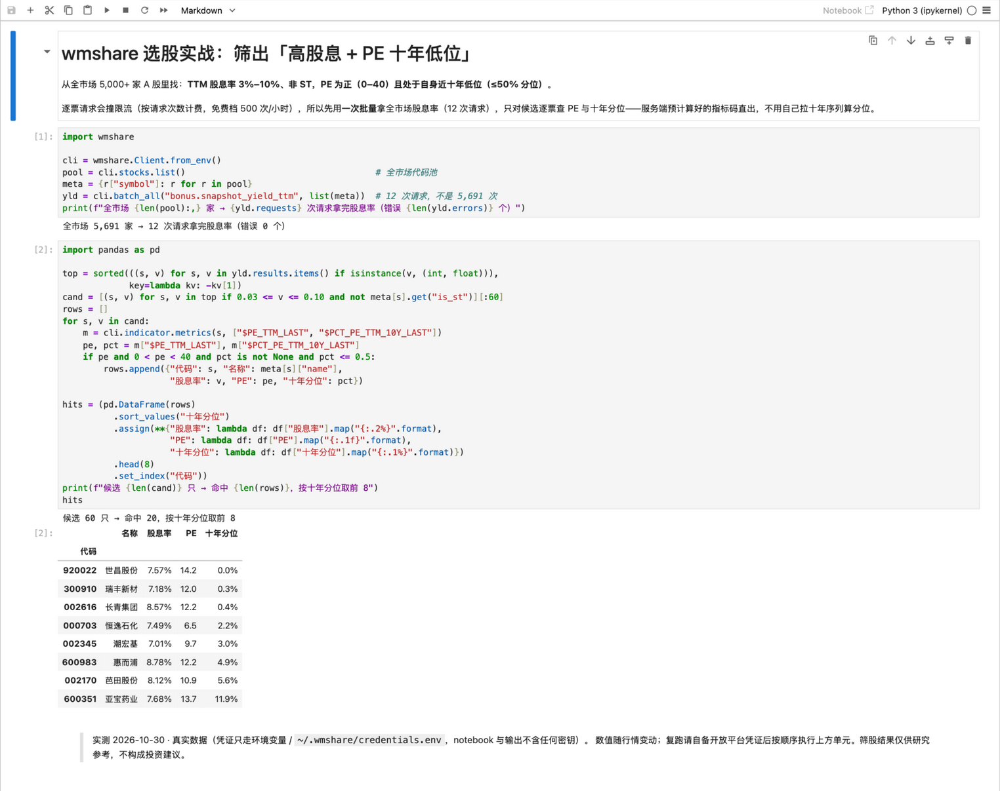

# wmshare

[](https://pypi.org/project/wmshare/) [](https://pypi.org/project/wmshare/) [](https://github.com/open-winmale/wmshare/actions/workflows/ci.yml) [](LICENSE)

> **English TL;DR** — `wmshare` is a BSD-3-Clause Python SDK for China A-share / Hong Kong / US
> market data: k-line (3 adjustments), intraday snapshots, money flow, financial statements,
> 2,158 precomputed metric codes (TTM / percentile / dividend), a screener facade and whole-market
> batch (5,691 symbols = 12 requests); ships an offline catalog, base-unit data guards and an
> AI-agent skill. **Credentials required** — get them on the open platform (open.winmale.com);
> try offline first with `wmshare.demo_client()`. **Install**: `pip install wmshare`.

给 Python 量化开发者的中文财经数据 SDK：一行接口拿到清洗好的 A股/港股/美股数据——
估值分位、TTM 股息率等指标**服务端算好直出**，全市场批量 **12 次请求**绕开限流。
凭证在开放平台（open.winmale.com）获取后即可取数；各市场逐能力明细见[「市场覆盖」](#市场覆盖)。

## 目录

[特性](#特性) · [快速上手](#快速上手) · [能力一览](#能力一览) ·
[市场覆盖](#市场覆盖) · [我想做 X → 用哪一行](#我想做-x--用哪一行) · [批量取数](#批量取数) ·
[单位与数据守护](#单位与数据守护) · [许可与数据服务](#许可与数据服务) · [更多](#更多)



## 特性

- **数据要全**——17 个数据域、116 个核心接口一站取全：K 线（三种复权、1 分钟分时、
  盘中快照、ETF/指数）、分红、三大报表、资金流、公告、业绩预告、股东治理（十大股东/
  质押（明细/比例/分布）/限售解禁/机构持仓/沪港通/国家队/高管增减持/股本结构）、回购、并购重组、
  融资融券、可转债、盈利预测、指数成分与估值、全市场列表、港美股披露。
- **数据要准**——财报按最新会计准则归一，跨年跨公司直接比较；全库基础单位
  （比率/涨跌幅=小数、金额=元、量=股），每次返回做量级守护与不变量校验，错误的量级到不了你的代码。
- **特色数据**——盘中实时快照与当日 1 分钟分时；`cli.screener` 筛选一行直出，全市场涨跌
  全景/分桶/行业分布/涨跌榜走服务端预计算索引，毫秒级响应；2,158 个指标码（TTM、3/5/10 年
  历史分位、192 个行业内分位、TTM 股息率/派息率 + 11 个质量筛选器）服务端算好直出。
- **凭证即用**——开放平台签发 client_id/api-key，环境变量、凭证文件、构造参数任选其一配置；遇到 401/403/429 错误消息即完整指引。
- **目录随包 + AI 原生**——252 个底层函数、116 个核心接口、2,158 个指标码离线可查；
  附 Agent Skills 格式 skill（`wmshare.skill_dir()`），复制进 AI agent 即可正确使用。

## 快速上手

### 安装

```bash
pip install wmshare                  # 基础安装
pip install "wmshare[dataframe]"     # 可选：pandas 支持（_df=True）
python3 -c "import wmshare; print(wmshare.__version__)"   # 验证安装
```

国内直连不稳时换清华源：`pip install -i https://pypi.tuna.tsinghua.edu.cn/simple wmshare`（镜像滞后时回官方源）；升级 `pip install -U wmshare`（Windows 用 `py -m pip install -U wmshare`）；开发者安装见 [CONTRIBUTING.md](CONTRIBUTING.md)。

### 配置凭证

凭证在 [开放平台](https://open.winmale.com)「我的 → 开放平台 → 我的应用」页获取 `AppId（Client ID）` 与 `API Key（Client Secret）` 两个值（缺一不可），配置方式任选其一：

```bash
export WMSHARE_CLIENT_ID=<AppId> WMSHARE_CLIENT_SECRET=<API Key>   # 方式一：环境变量
# 方式二：~/.wmshare/credentials.env（KEY=VALUE 每行一条）
# 方式三：构造参数 cli = wmshare.Client(client_id="...", client_secret="...")
```

### 选股实战：10 行筛出「高股息 + PE 十年低位」

逐票请求全市场会撞限流（5,691 家 = 5,691 次请求），所以先用一次批量拿到股息率（12 次请求），只对候选逐票查 PE 与十年分位：

```python
import wmshare
cli = wmshare.Client.from_env()
pool = cli.stocks.list()                                     # 全市场 5,691 家
meta = {r["symbol"]: r for r in pool}
yld = cli.batch_all("bonus.snapshot_yield_ttm", list(meta))   # 12 次请求，不是 5,691 次
top = sorted(((s, v) for s, v in yld.results.items() if isinstance(v, (int, float))),
             key=lambda kv: -kv[1])
cand = [(s, v) for s, v in top if 0.03 <= v <= 0.10 and not meta[s].get("is_st")][:60]
rows = []
for s, v in cand:
    m = cli.indicator.metrics(s, ["$PE_TTM_LAST", "$PCT_PE_TTM_10Y_LAST"])
    pe, pct = m["$PE_TTM_LAST"], m["$PCT_PE_TTM_10Y_LAST"]
    if pe and 0 < pe < 40 and pct is not None and pct <= 0.5:
        rows.append((s, meta[s]["name"], v, pe, pct))
rows.sort(key=lambda r: r[4])
for s, n, v, pe, pct in rows[:8]:                            # 取前 8 行打印
    print(f"{s}  {n}  股息率 {v:.2%}  PE {pe:.1f}  十年分位 {pct:.1%}")
```

没配凭证也能先看调用面：`cli = wmshare.demo_client()`（同签名、随包快照、不联网），换成 `Client.from_env()` 即接真实数据。

## 能力一览

随包离线目录：**17 个数据域 · 252 个底层函数 · 2158 个指标代码**；友好层 **116 个核心接口**，
按使用视角组织为（11 个指标组、74 个精选常用指标代码，`cat.search("中文")` 可编程检索）：

| 门面 | 核心能力 | 单位口径 |
|---|---|---|
| `cli.kline` | 日 K 三种复权（自上市首日起全覆盖，最早 1991 年）、最新/盘中快照、1 分钟分时、ETF/指数 | 价格=元、量=股、涨跌幅=小数 |
| `cli.screener` | 单票筛选器（涨停/均线/动量/回撤/放量）+ 全市场涨跌全景/分桶/行业分布/涨跌榜 | 阈值=小数；涨跌家数统计的 `*_pct`=百分数数值 |
| `cli.moneyflow` | 主力/超大单/大单/中单/小单净流入（日频+盘中） | 金额=元 |
| `cli.statements` | 三大报表多期、合并 vs 母公司、目录树、审计意见 | 报表原币元 |
| `cli.segments` | 经营分部：分产品/业务/区域收入构成 | 元；比率=小数 |
| `cli.indicator` | 按指标码取数：估值/盈利/成长/现金流/杜邦 | 比率=小数 |
| `cli.valuation` | PE/PB/PS/市赚率(PR)的历史统计与分位（窗口上限 3 年） | 分位=小数 |
| `cli.notice` | 公告检索、回购/减持信号 | — |
| `cli.filings` | 定期报告清单与最新 | — |
| `cli.forecast` | 业绩预告/快报、财报披露日历 | 同比=小数 |
| `cli.dividend` | 分红历史、TTM 股息率/派息率、质量筛选器 | 率=小数、DPS=元/股 |
| `cli.equity` | 股东治理：十大股东/股东户数/质押/解禁/机构持仓/沪港通/国家队/高管增减持/股本/回购/并购重组/关联交易/担保/诉讼 | 比例=小数、金额=元、量=股 |
| `cli.margin` | 个股融资融券（融资买入/偿还/余额、融券卖出/偿还/余量） | 金额=元、量=股 |
| `cli.estimates` | 机构盈利预测（逐年 EPS/PE）、预测明细、评级统计、个股研报 | EPS=元/股、PE=倍 |
| `cli.cbond` | 可转债合约快照、条款事件、正股关联、强赎计数、日 K 与盘中 1 分钟 | 价格=元（面值 100） |
| `cli.workout` | 契约套利条款（要约收购/换股/现金选择权）看板与单票查询 | 价格=元 |
| `cli.index` | 指数键列表、成分股（市值/估值中枢）、权重股、宽基估值时序 | 市值=元、比率=小数、权重=小数 |
| `cli.stocks` | 全市场证券列表（代码/名称/交易所/三级行业/上市日/ST）、行业目录（申万/恒生）、行业成分股（中文名直达） | listed=YYYY-MM-DD、is_st=布尔 |
| `cli.intl` | 港股 CCASS（中央结算持仓）/主要股东/机构评级/盈利预测，港美沽空，美股发行信息 | 量=股、占比=小数、价格=披露币种 |
| `cli.info` | 公司档案（名称/行业/组织类型/上市日期） | — |

## 市场覆盖

| 数据能力 | A股 cn | 港股 hk | 美股 us |
|---|---|---|---|
| 日 K 三种复权 / 1 分钟分时 / 盘中快照 | ✅ 全量 | ✅ | 快照/盘中新鲜；历史日 K 停更（见注记） |
| 指标库（2,158 码：估值/盈利/成长/分红/分位） | ✅ | ✅ | ✅（用裸代码 `AAPL`；`AAPL.O` 由 SDK 归一） |
| 分红：历史、TTM 股息率/派息率、质量筛选 | ✅ | ✅ | ✅（窗口口径固定） |
| 公告与披露信号 | ✅ | ✅ | — |
| 财报清单与最新披露 | ✅ | ✅ | — |
| 股东治理：高管名册 / 高管增减持 / 股本变更 | ✅ | ✅ | ✅（仅股本变更） |
| 股东治理：十大股东 / 质押 / 解禁 / 机构持仓 / 重组 / 担保 / 诉讼 / 股东户数 | ✅ | — | — |
| 全市场选股：单票筛选器 / 涨跌全景 / 高息池 | ✅ | 部分（单票筛选可用；高息池索引暂缺） | — |
| 港美专项：CCASS / 主要股东 / 机构评级 / 盈利预测（`cli.intl`） | — | ✅ | — |
| 港美专项：沽空（`cli.intl.query_sellshort`） | — | ✅ | ✅ |
| 港美专项：发行信息（`cli.intl.issue_info`） | — | — | ✅ |
| 资金流 / 两融 / 可转债 / 业绩预告 / 盈利预测研报 / 经营分部 / 契约套利 | ✅ | — | — |
| 全市场列表 / 行业目录 / 行业成分（`cli.stocks`） | ✅ | ✅ | 列表 ✅（美股代码表手动刷新有滞后）；行业目录树暂缺 |
| 离线代码表 + 检索（`cat.symbols_search`） | ✅ | ✅ | ✅ |

市场切换：`Client(market="cn" / "hk" / "us")`，缺省 cn；代码与市场不匹配会被服务端直接拒绝（如 cn 市场查
`00700` 报 market mismatch）。美股用裸代码（`AAPL`/`BRK_B`），`AAPL.O`/`BRK.B` 由 SDK 按代码表自动归一；`cli.intl` 港美股披露也要用对应市场客户端调用。

如实注记（2026-10-30 实测）：港/美列 ✅ 均经 live 探针逐族验证；**美股代码用裸代码**（`AAPL` / `BRK_B`）——
带交易所后缀的 `AAPL.O`/`BRK.N` 会被上游当成宏观序列（symbol 未绑定：`_LAST` 族 500、分位静默返 0），
SDK 已按随包代码表自动归一，裸代码实测正常（AAPL PE 39.5、10 年分位 78.6%）；美股日 K 停更于
2026-03-13（live-only），最新价量用 `cli.kline.live / snapshot`；港美 K 线量额单位已随 1.x 修复；
深研宽表暂仅 cn，港美科目级数据经指标码可查；hk 十大流通股东与回购数据管线已有、SDK 接口待路由。

## 我想做 X → 用哪一行

| 我想做… | 一行接口 | 省掉的计算 |
|---|---|---|
| 看 TTM 股息率 | `cli.dividend.yield_ttm(sym)` | 拉全部分红史→截 TTM 窗→查市值→相除 |
| 判断估值贵不贵 | `cli.indicator.get(sym, "$PCT_PE_TTM_10Y_LAST")` | 拉十年估值史自己算百分位 |
| 看估值历史均值/中位/分位 | `cli.valuation.hist_stats(sym, "pe", "3y")` | 拉 3 年估值序列→自己算统计量 |
| 看公司在行业里的位置 | `$CUR_IND_ROE_PCT_LAST`（行业内 ROE 分位，1=行业最高） | 拉全行业成分→逐票取 ROE→排序 |
| 筛高股息且派息可持续 | `cli.dividend.screen_quality(sym)` | 自写股息/派息率质量模型 |
| 站上 20 日线了吗 | `cli.screener.screen_above_ma20(sym)` | 拉 K 线→算均线→比较 |
| 全市场今天涨跌如何 | `cli.screener.index_breadth_summary()` | 全市场扫描→聚合统计 |
| 看最新十大股东 | `cli.equity.query_holder10(sym)` | 翻定期报告→抄股东名单 |
| 质押比例高不高 | `cli.equity.query_pledge_summary(sym)` | 翻质押公告→逐笔累加 |
| 下半年解禁压力大吗 | `cli.equity.query_release(sym)` | 翻解禁公告→手工排期 |
| 两融余额什么水平 | `cli.margin.query(sym)` | 翻交易所两融披露→对日期 |
| 券商怎么看这只票 | `cli.estimates.query_forecast(sym)` | 汇总各家研报预测→自己算均值 |
| 沪深300 都有谁 | `cli.index.members("index.hs300", "mv", 10)` | 找成分表→自己拉行情 |
| 这票正股有哪些转债 | `cli.cbond.of_stock(sym)` | 翻转债名录→逐只对正股 |
| 港股筹码在谁手里 | `cli.intl.query_ccass(sym)` | 上披露易→逐日查 CCASS |
| 今日涨幅榜前十 | `cli.screener.index_top_movers(limit=10)` | 全市场扫描→排序→取头部 |
| 近半年有无回购/减持 | `cli.notice.has_buyback(sym, "6m")` | 拉公告列表→分类匹配→截窗 |
| 合并与母公司差多少 | `cli.statements.compare(sym)` | 双表对齐→逐科目相除 |
| 拿全市场代码池 | `cli.stocks.list()` | 逐页拼列表→核对代码格式 |
| 银行股都有谁 | `cli.stocks.industry_members("银行")` | 查行业分类→逐票打标签 |

**常用示例（输出为预期量级；`cli.kline.bars` / `statements.income` 等其余接口同风格）**：

```python
import wmshare

cli = wmshare.Client.from_env()

# TTM 股息率：小数口径，0.0396 = 3.96%
print(cli.dividend.yield_ttm("600519"))                      # 0.0396

# 估值温度计：PE(TTM) 处于近 10 年 42% 分位（小数）
print(cli.indicator.get("600519", "$PCT_PE_TTM_10Y_LAST"))   # 0.42

# 行业定位：ROE 在同行业内的分位（1.0 = 行业最高；茅台 ROE 为行业之最）
print(cli.indicator.get("600519", "$CUR_IND_ROE_PCT_LAST"))  # 1.0

# 技术面一行布尔：是否站上 20 日均线
print(cli.screener.screen_above_ma20("600519"))              # True

# 全市场涨跌全景：服务端索引直出，免本地扫描（*_pct 百分数、median_pct 小数）
print(cli.screener.index_breadth_summary())
# {'total': 5685, 'up': 4567, 'down': 934, 'flat': 184, 'up_pct': 80.3, ...}

# 分红质量：高股息 + 派息可持续（默认精品窗口=派息率 30%–70%，可显式放宽）
print(cli.dividend.screen_quality("600519", min_yield=0.02, payout_max=1.5))  # True

# 公告信号：近 6 个月是否有回购公告
print(cli.notice.has_buyback("600519", "6m"))                # True

# 全市场列表 / 行业成分（中文名直达，也可传 "S48"）/ 批量：单标的接口传 list 即批量（≤500/批）
rows = cli.stocks.list()                 # A 股 ≈5.7k 行：代码/名称/交易所/行业/上市日；港/美换 market
banks = cli.stocks.industry_members("银行")
df = cli.call_batch("kline.snapshot", ["600519", "000001"]).to_df()   # 带 symbol 列的长表；to_df 需 pandas
```

以上能力全部在离线目录可查（`cat = wmshare.load()` 后）：`cat.search("分位")`、`cat.metrics_in_group("dividend")`。

## 批量取数

服务端按**请求次数**限流（免费档 500 次/小时、5,000 次/日）：逐票取 A 股 5,691 家 = 5,691 次请求必然撞 429，批量只需 **12 次**。

```python
import wmshare
cli = wmshare.Client.from_env()

# ① 一站式：自动分批（默认 500/批）聚合为一个结果（A 股全市场 = 12 次请求）
codes = [r["symbol"] for r in cli.stocks.list()]      # 全市场代码池（港/美换 market）
res = cli.batch_all("kline.snapshot", codes)
print(len(res.results), res.requests)                 # 5,691 12

# ② 逐批：可进度、可中断、长任务边取边落盘
for i, part in enumerate(cli.batch_iter("dividend.history", codes), 1):
    print(f"第 {i} 批 {len(part.results)} 家")          # part.to_df() 可自行落盘

# ③ 单批（≤500）：cli.call_batch("kline.snapshot", ["600519", "000001"]).to_df()
```

三个入口的参数与语义对照：

| 接口 | 用途 | 请求数（N 个标的） | 关键参数（默认） |
|---|---|---|---|
| `batch_all(name, symbols)` | 一站式：自动分批并聚合 | ⌈N/batch_size⌉ | `batch_size=500`（须 ≤`max_limit`）；`on_batch_error="raise"`／`"skip"` 跳失败批 |
| `batch_iter(name, symbols)` | 逐批流式：可进度／中断／落盘 | ⌈N/batch_size⌉ | 同上；逐批 yield `BatchResult`（`requests` 恒 1） |
| `call_batch(name, symbols)` | 单批（≤500） | 1（`on_error="raise"`）／N（`"skip"` 逐票） | `on_error` 是**票级**，勿用于容错 |

`name`/`symbols` 都是**位置参数**；`_raw=True`、`_units="native"` 三个入口通用。**`on_batch_error`
（批级：跳过整批）≠ `on_error`（票级：逐票请求）**。长表用 `to_df()`，批量入口不提供 `_df`。
**指标码不是批量 `name`**：`name` 必须是目录函数名（252 个，如 `kline.snapshot`）；一票多码用 `cli.indicator.metrics(sym, codes)`，全市场指标码只能逐票调用。

**分批策略由你定，SDK 负责切片与执行**：代码池来自 `cli.stocks.list()`（全市场）、
`cli.stocks.industry_members("银行")`（按行业）或自己的筛选结果，`batch_size=`（默认 500、
上限 `max_limit`）控制每批大小；单批触发 `CALC_LIMIT_EXCEEDED`（算力超限）时减小 `batch_size`。
限流（429）在任何模式下都会停止并给续跑位置（消息含已完成标的数与 `codes[done:]` 切片），不会闷头连败。

**市场边界**：一个批次只能是**同一市场**——`Client(market="cn")` 只传 A 股代码，混入港股/美股
代码会直接报错（网关只校验请求参数里的代码，不逐个校验批内；他市场代码会在本市场
引擎里走错数据管线，返回的 close/涨跌幅不可信）。跨市场请分别调用：A 股 12 批 + 港股 6 批 + 美股 11 批 = 29 次请求。

**容错**：`batch_all(on_batch_error="skip")` 跳过失败的**批**继续（失败批进 `errors`，键如 `batch#3[1000:1500]`）。
**不要用 `call_batch(on_error="skip")` 做容错**——它逐票发请求，12 批会放大成 5,691 次、正好制造 429。

**返回**：`results`（`{代码: 结果}`，保序去重 + 代码归一）/ `errors` / `requests`（实际请求数，
可对比标的数看省了多少配额）；`to_df()` 每标的一行（MAP 展平、`symbol` 列在前），多次行结果
（`bars`/`history`）建议读 `results[代码]` 或走 `batch_iter`。实测（2026-10-30）：500 标的单批
0.7–4 秒（随网络波动），A 股全市场 5,691 家 12 批 9–16 秒一次跑完（0 错误）。

## 单位与数据守护

全库统一基础单位：**比率 / 涨跌幅 = 小数**（0.01 = 1%，ROE 0.332 = 33.2%）、
**金额 / 价格 / 市值 = 元**（报表原币）、**成交量 = 股**；各接口单位口径见「能力一览」表。
返回前做量级与关系不变量校验，违例抛 `DataError`——错误的量级到不了你的代码。
需要脚本原始口径时：`_raw=True`（上游原始行）、`_units="native"`（保留上游原单位，如手/百分数）、`Client(validate=False)`（关校验留换算）。

数据深度：个股/ETF 日 K 覆盖**自上市首日以来的全部交易日**（最早 1991 年）；单次区间上限 5 年、
默认单次 500 根（`Client(max_limit=...)` 可调）；深回溯老数据可能触发守护，整段历史时 `validate=False`。

## 许可与数据服务

- 代码采用 [BSD-3-Clause](LICENSE)：可自由使用、修改、再分发（**含商业用途**），保留版权声明即可。
- 云端数据服务需 [开放平台](https://open.winmale.com) 账号：免费档为 500 次/小时、5,000 次/日，
  更高额度与服务条款以开放平台为准。
- 数据仅供研究参考，不构成任何投资建议。

## 更多

- **AI agent skill（随包分发）**：复制进 agent 的发现目录，AI 即可正确使用 SDK（目录先行防臆造指标码、单位铁律、错误引导都在 skill 里）：

  ```bash
  cp -r "$(python3 -c 'import wmshare; print(wmshare.skill_dir())')" ~/.agents/skills/wmshare
  ```
  源文件：[src/wmshare/skills/wmshare/SKILL.md](src/wmshare/skills/wmshare/SKILL.md)（LLM 可直接读取；项目级按工具放入 .zcode/skills/ 或 .claude/skills/）。

- 生态工具 [big-winner](https://github.com/open-winmale/big-winner)：基于本 SDK 构建的开源工具（收息与估值区间参考）。
- **文档中心 [docs/](docs/README.md)**：使用指南 GUIDE（单票菜谱/批量/多市场/故障排查）· AI 用法 · llms.txt 索引 · [API 参考](docs/API.md)（四大类 116 个核心接口 + 指标组）
- **示例课程 [examples/](examples/README.md)**：11 个编号示例（入门→进阶→生产→AI），全部支持演示客户端离线试跑，CI 端到端覆盖
- **Notebook 实战 [docs/notebooks/quickstart.ipynb](docs/notebooks/quickstart.ipynb)**：首屏选股实战的可执行 notebook（含真实运行输出），配好凭证按序执行即可复跑，也可上传到任意云端 Notebook 环境
- **OpenAPI / Swagger**：[docs/openapi.json](docs/openapi.json)（OpenAPI 3.1，可导入 Apifox /
  Postman）；[docs/swagger.html](docs/swagger.html)（已内联 spec，浏览器直接打开；UI 资源走 CDN，
  若限制 `file://` 可在 docs 目录起 `python -m http.server`）
- 类型化门面：全部目录命名空间带类型签名与 docstring（`py.typed`），IDE 直接补全；单次拉取上限 `Client(max_limit=500)` 可调
- [贡献指南](CONTRIBUTING.md)：提交门禁、内容规范、许可政策
- 运行测试：`pytest`（不联网）；`WMSHARE_LIVE=1 pytest tests/test_live.py`（真实冒烟）
